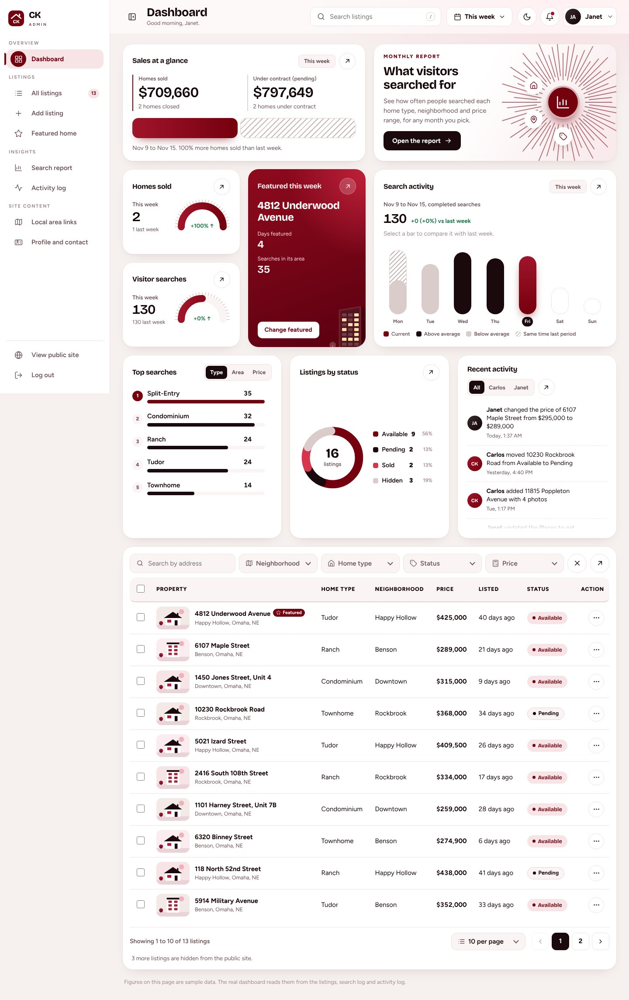
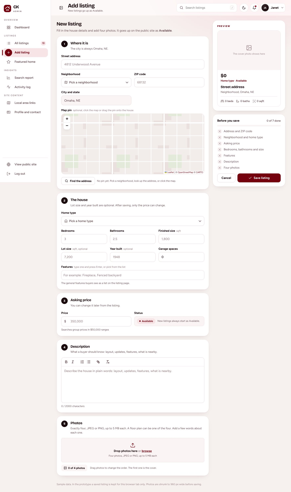
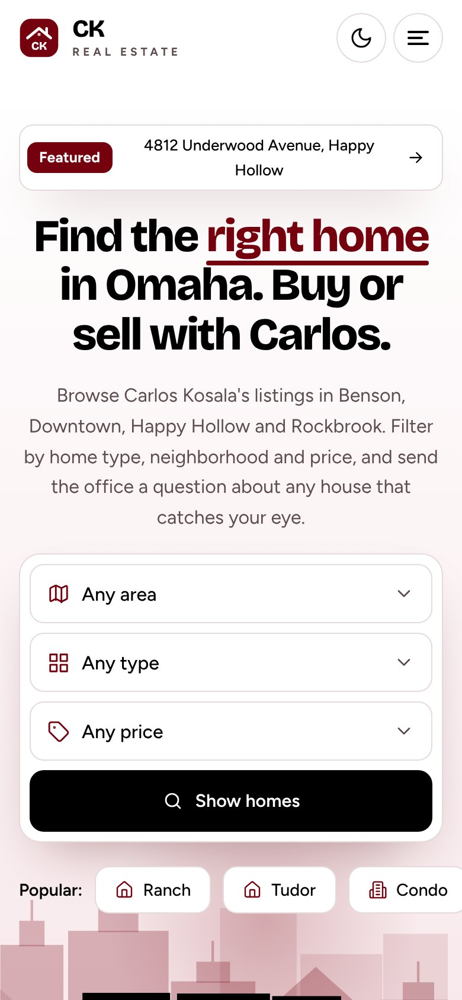

# CK Real Estate

This is a website for broker Carlos Kosala's office in Omaha. Visitors browse homes for sale, and Carlos and his office administrator Janet manage the listings.

The project was built by Team 3 for ISQA 8210 Management of Software Development at the University of Nebraska at Omaha in Fall 2026. The site runs on Django 5.2 with Python 3.12 and is hosted on PythonAnywhere.

## Live links

| What | Address |
| --- | --- |
| Live site | https://ejvincent10.pythonanywhere.com/ |
| Admin log in | https://ejvincent10.pythonanywhere.com/manage/ |
| Testing site | https://gigson2.pythonanywhere.com/ |
| Kanban board (Trello) | https://trello.com/b/pak3uqXw/ck-real-estate-kanban |

The administrator accounts are shared privately. Ask the team if you need one. New work is checked on the testing site first, then deployed to the live site from `main`.

## Project status

| Sprint | Stories | Status |
| --- | --- | --- |
| Sprint 2 (Nov 2 to Nov 23) | US-01 Log in, US-02 Log out, US-03 Add a listing | Done and live since Nov 21, 2026 |
| Sprint 2 stretch | US-05 Browse all listings | Landing page and listings page built. Real listing photos wait on US-04 |
| Sprint 3 (Nov 23 to Dec 14) | Next stories by backlog priority | Planned |

This table was last updated on November 22, 2026. The Scrum Master updates it at the end of each sprint.

## What the site does today

Visitors can see the landing page and the featured home, and they can browse every active listing. They can filter the listings by neighborhood, home type and $50,000 price range. The site works on a phone, and it has a light and a dark mode.

Carlos and Janet can log in and log out of the admin area. The dashboard shows counts for their listings, and the listings page has search, filters and paging. They can add a new listing with its features, an optional map pin and a formatted description. The site records every log in, log out and new listing, with who did it and when.

The next stories are listing photos (US-04), the listing details page (US-06), price and status changes, choosing the featured home, inquiries by email and the monthly search report. The product backlog and the Trello board list every story.

## Screenshots

These images come from the design mockups. The live site now uses real photography, but the layouts are the same.

| Admin dashboard | Add a listing | Home page on a phone |
| --- | --- | --- |
|  |  |  |

All of the mockups are in [docs/design/mockups/v3](docs/design/mockups/v3/).

## Tech stack

| Part | Choice |
| --- | --- |
| Backend | Django 5.2 on Python 3.12 |
| Database | SQLite, built with Django migrations from Cole's data model |
| Frontend | Django templates, two CSS files and plain JavaScript, with no build step |
| Libraries | Tom Select, Quill, DOMPurify, Leaflet, IMask, flatpickr and FilePond, stored in `static/vendor/` |
| Security | Django authentication, CSRF protection, descriptions cleaned with nh3 |
| Hosting | PythonAnywhere, with separate testing and live accounts |
| Version control | GitHub, one branch per member and reviewed pull requests into `main` |

The course requires a Django application deployed on PythonAnywhere, so the team chose this stack.

## Project structure

```
accounts/      log in, log out and administrator accounts
listings/      listings, lookup tables, admin and public pages
reports/       activity log and search log
siteprofile/   broker profile (Sprint 3)
localarea/     local area page (Sprint 3)
inquiries/     email-only inquiry forms (Sprint 3)
templates/     page templates
static/        CSS, JavaScript, images and vendor libraries
prototype/     clickable HTML design reference
deploy/        PythonAnywhere setup scripts
markdown/      blueprint, deployment, data model and status notes
docs/design/   mockups
tests/         JavaScript tests
```

## Run it locally

You need Python 3.12 and Git on your computer. The commands below clone the project, create a virtual environment, install the requirements and copy the settings file.

On Windows (PowerShell):

```powershell
git clone --branch main https://github.com/anabel-codes/ISQA8210-TermProject.git
cd ISQA8210-TermProject
py -3.12 -m venv .venv
.\.venv\Scripts\Activate.ps1
python -m pip install -r requirements.txt
Copy-Item .env.example .env
```

On macOS or Linux:

```bash
git clone --branch main https://github.com/anabel-codes/ISQA8210-TermProject.git
cd ISQA8210-TermProject
python3.12 -m venv .venv
source .venv/bin/activate
python -m pip install -r requirements.txt
cp .env.example .env
```

The next step is to create a secret key and paste it into `DJANGO_SECRET_KEY` in your `.env` file. Keep `DJANGO_DEBUG=1` while you work locally.

```
python -c "from django.core.management.utils import get_random_secret_key; print(get_random_secret_key())"
```

After that, set up your own database and start the server:

```
python manage.py migrate
python manage.py seed_lookups
python manage.py create_admins --interactive
python manage.py runserver
```

The `create_admins --interactive` command asks for the Carlos and Janet passwords and never stores them in a file. It keeps any passwords that already exist.

| Local address | Page |
| --- | --- |
| http://127.0.0.1:8000/ | Public site |
| http://127.0.0.1:8000/manage/login/ | Admin log in |
| http://127.0.0.1:8000/django-admin/ | Django administration (team only, after `createsuperuser`) |

If you want sample listings on your own machine, run `python manage.py seed_demo`. This command is for local work only and must never run on the live site.

## Configuration

The settings live in a `.env` file, which is never committed. The `.env.example` file lists the setting names.

| Setting | What it does |
| --- | --- |
| `DJANGO_SECRET_KEY` | Signs sessions and forms. Use a different long random value on every machine |
| `DJANGO_DEBUG` | `1` for local work, `0` on PythonAnywhere |
| `DJANGO_ALLOWED_HOSTS` | Addresses the site answers to, such as `127.0.0.1,localhost` |
| `DJANGO_EMAIL_BACKEND`, `EMAIL_HOST`, `EMAIL_PORT`, `EMAIL_HOST_USER`, `EMAIL_HOST_PASSWORD`, `EMAIL_USE_TLS` | Outgoing email. Locally, emails print in the terminal |
| `OFFICE_EMAIL` | The office address that will receive visitor inquiries |
| `CK_CARLOS_PASSWORD`, `CK_JANET_PASSWORD` | Optional, for the non-interactive `create_admins` command only |

The `.env` file, `seed/admins.json`, `db.sqlite3` and uploaded media are never committed to the repository.

## Tests

Run these three checks before every push:

```
python manage.py check
python manage.py test
python manage.py makemigrations --check --dry-run
```

The tests cover every acceptance criterion for US-01 to US-03. They also cover security cases such as non-administrator accounts, CSRF protection, logging out without JavaScript and tampered form fields. The admin notification timers have a separate JavaScript test in the `tests/` folder: `node --test tests/admin-feedback.test.cjs`. Deployment helper checks run with `python -m unittest discover -s deploy -p "test_*.py"`.

Every new story comes with its own tests, and all of the tests must pass before a merge.

## Deployment

Ethan deploys to the live site, and he deploys from `main` only. New work is tried on the testing site first.

On the server, an update looks like this:

```bash
cd ~/ck-real-estate
git switch main
git pull --ff-only origin main
CK_PYTHON=python3.12 CK_VENV="$HOME/.virtualenvs/ck-real-estate" bash deploy/prepare_pythonanywhere.sh
```

Ethan reports Python 3.12, `/home/ejvincent10/ck-real-estate` as the project directory, and `/home/ejvincent10/.virtualenvs/ck-real-estate` as the virtual environment. The testing account remains on Python 3.13. These environments have separate databases and administrator accounts. Creating a local administrator does not create a deployed account.

After these steps, reload the web app from the PythonAnywhere Web tab. The database and the uploaded media exist only on the server, so back up `db.sqlite3` before running migrations. The full first-time setup is in [markdown/PYTHONANYWHERE.md](markdown/PYTHONANYWHERE.md).

## Team workflow

Each member works on their own branch, named `<name>-development`, and opens a pull request into `main`. At least one teammate reviews every pull request, and nobody merges their own.

Before you push, run `git fetch origin` and `git merge origin/main`, then run the three checks above. Each commit message names its story, for example `feat(listings): add listing validation (US-03)`. Tell the team before you create a migration, and build stories in priority order from the backlog.

A story is done when its tests pass, it matches the mockup, it works on a phone, it is merged after review, and it is live on PythonAnywhere.

## Team

| Member | Contribution |
| --- | --- |
| Gage Heithold | Scrum Master (Sprint 2), Gantt chart, contact with the product owner |
| Twumasi Adomako | Frontend and interface design, prototype and mockups, Kanban board, US-01 to US-03 build |
| Ethan Vincent | Deployment to PythonAnywhere, product backlog, first live listings |
| Cole Beiermann | Data model and SQL |
| Anabel Diaz | Cost-benefit analysis, repository owner |
| Jake Madison | User descriptions and user stories (Sprint 0) |

The product owner is Paul van Vliet. The Scrum Master role rotates each sprint.

## Project documents

- [Blueprint](markdown/BLUEPRINT.md): the scope, decisions and design system
- [Data model mapping](markdown/DATABASE_MAPPING.md): Cole's data model and how Django implements it
- [PythonAnywhere deployment](markdown/PYTHONANYWHERE.md): the full server setup
- [Deployment handoff](markdown/DEPLOYMENT_HANDOFF.md): the notes for the person who deploys
- [Sprint 2 status](markdown/SPRINT2_STATUS.md): the test evidence and endpoints
- [Photo credits](markdown/PHOTO_CREDITS.md): the photographers whose images the site uses
- [Data model SQL](CKRealEstateDatabase.sql): the original SQL script
- [Trello board](https://trello.com/b/pak3uqXw/ck-real-estate-kanban): the Kanban board for every story

The sprint documents, such as the backlog, Gantt chart, cost-benefit analysis, meeting minutes and retrospectives, are submitted through the course site.

## Credits

The photographs on the site come from Unsplash photographers, who are credited in [markdown/PHOTO_CREDITS.md](markdown/PHOTO_CREDITS.md). The libraries in `static/vendor/` keep their own open-source licences.

This is an unlicensed course project for ISQA 8210. The sample listings, prices and descriptions are fictional.
