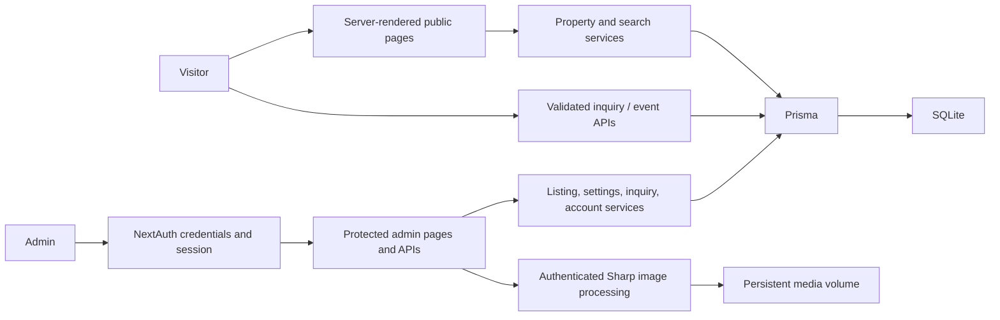

# Application architecture

## Context and decisions

The original repository contained a README and no application. This implementation uses the requested modular monolith: one Next.js App Router application, one database, and one media directory. There are no independent frontend servers or microservices. Prisma 7 uses an explicit SQLite adapter. Integer cents avoid floating-point monetary storage; input permits two decimal places up to $20 million.

React server components render database-backed public and protected pages. Small client components handle form submission, gallery selection, navigation, image ordering, and analytics. Tailwind's CSS entry point and reusable custom CSS tokens define the ivory/forest design. System sans-serif and Georgia avoid runtime font downloads.

## Source organization

- `src/app`: pages, route handlers, layouts, loading and error states.
- `src/components`: shared property cards, search/inquiry forms, galleries, navigation, admin editors.
- `src/lib`: Prisma client, validation, database search construction, listing transactions, settings, authorization, rate limits, HTTP errors, analytics.
- `prisma`: normalized schema, initial migration, idempotent sample seed.
- `scripts`: environment-based account initialization, isolated E2E runner, analytics retention.
- `tests`, `e2e`: service/component tests and desktop/mobile workflows.

## Public data flow

`GET /properties` reads URL parameters, normalizes numbers/ranges, constructs a Prisma filter, counts results, clamps the page, and fetches at most nine records. Ordering includes an ID tie-breaker. Drafts are excluded at query time. Property detail pages query `published: true`, returning a 404 for drafts and absent IDs. Images/features use relational includes; public queries do not include user or inquiry records.

The inquiry form performs client-side Zod validation, then POSTs to the server. The server enforces origin, rate limit, honeypot, schema, and optional listing publication. A transaction stores both the inquiry and its engagement event. No email provider is necessary to persist the message. Errors preserve the entered message; success is announced through an accessible status region.

## HTTP API

| Method and route                    | Access and behavior                                                                                                      |
| ----------------------------------- | ------------------------------------------------------------------------------------------------------------------------ |
| `GET/POST /api/auth/[...nextauth]`  | NextAuth sign-in, CSRF tokens, session, sign-out.                                                                        |
| `POST /api/inquiries`               | Public, same-origin, validated, five attempts per 15-minute bucket. Returns `{success:true}` with 201 after persistence. |
| `POST /api/events`                  | Public, same-origin, 120 attempts/minute. Accepts VIEW, SEARCH, FEATURED plus UUID dedupe key.                           |
| `POST /api/admin/properties`        | Administrator; validated listing and nested images/features; returns ID.                                                 |
| `PUT /api/admin/properties/[id]`    | Administrator; full validated edit in a transaction.                                                                     |
| `DELETE /api/admin/properties/[id]` | Administrator; confirmation body must match record ID.                                                                   |
| `POST /api/admin/upload`            | Administrator; JPEG/PNG/WebP, 4 MB file limit, 40 MP decode limit; re-encodes WebP with random filename.                 |
| `PATCH /api/admin/inquiries/[id]`   | Administrator; status and internal notes.                                                                                |
| `PUT /api/admin/settings`           | Administrator; validated known setting keys, transactional upserts.                                                      |
| `POST /api/admin/users`             | Administrator; hashes password before account creation.                                                                  |
| `PATCH /api/admin/users/[id]`       | Administrator; activate/deactivate or reset password, increment session version.                                         |
| `GET /uploads/[file]`               | Public immutable WebP asset; strictly validated random filename, persistent volume read.                                 |

Errors return `{error: string}` with 400 validation, 401 authentication, 403 origin, 404 absent record, 409 duplicate, 413 oversized upload, 429 throttled, or controlled 500 responses. There is no public inquiry-list or user-list API. Public catalog reads use server rendering rather than downloading full datasets.

## Authentication and authorization

NextAuth's maintained credentials flow provides signed/encrypted JWT sessions and CSRF-protected login/logout. Passwords use bcrypt with cost 12 and require 12–72 characters (at most 72 UTF-8 bytes). Sessions last eight hours. Every protected page and API checks the current database account, active flag, ADMIN role, and session version. Disabling an account or resetting a password invalidates previous sessions on their next protected request. The layout redirects visitors to `/login`; APIs return 401. Public visitors need no account.

All custom mutations require the configured canonical origin. React escapes text; no submitted HTML is rendered. Prisma parameterizes database access. Security headers include frame denial, nosniff, permissions restrictions, referrer policy, and a CSP. Inline scripts/styles remain allowed for Next.js hydration; a strict nonce-based CSP is a future hardening option.

## Analytics and privacy

VIEW is emitted on a published detail page, SEARCH on an explicit filtered search navigation, FEATURED when arriving through a featured homepage card, and INQUIRY in the persistence transaction. The client reuses an event UUID for the same interaction within a browser session for 30 minutes. The database unique constraint prevents retry/Strict Mode duplicates. This is approximate deduplication, not identity verification or bot detection.

Analytics contain normalized filter values and optional property ID; they do not include inquiry contact details, messages, passwords, or raw IPs. Rate-limit keys hash trusted IPs with HMAC when proxy trust is enabled. Search text is user-supplied; operators should include search activity in their privacy notice. Events are tagged as test by server configuration. Production dashboards exclude test events.

The dashboard summarizes the latest 10,000 observations within 30 days. `analytics:prune` removes events older than 90 days and expired rate buckets. Inquiry retention is an explicit operational policy, not automatically destructive behavior.

## Tradeoffs and extension boundaries

SQLite and local persistent media suit a demonstration or single Node host. Production scale needs the PostgreSQL adapter and shared object media described in DEPLOYMENT. Upload removal detaches images from listings but does not delete disk files; this avoids accidental loss, at the cost of orphan cleanup. Real listings may be entered through administration; authorized feed imports should call the validated listing service and preserve provenance. No unauthorized feed integration is assumed.
