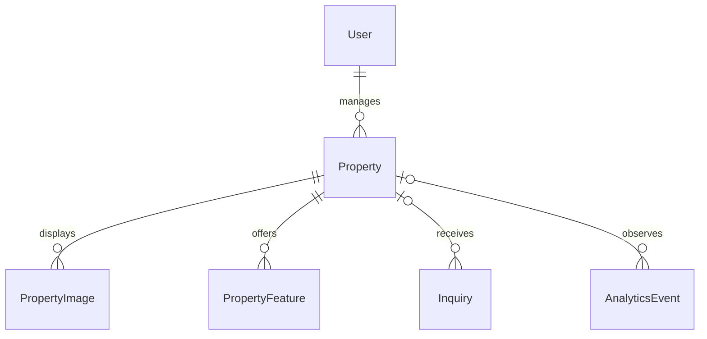

# Database design

Prisma's schema is the application data contract. The SQLite database is stored at `prisma/dev.db` by default and is ignored by Git. Prisma 7's connection URL is configured in `prisma.config.ts` for CLI migrations and in `src/lib/db.ts` for runtime. Relative URLs resolve from the repository root.

## Entities

| Entity          | Purpose and constraints                                                                                                                                                                                             |
| --------------- | ------------------------------------------------------------------------------------------------------------------------------------------------------------------------------------------------------------------- |
| User            | Unique lowercase email, name, bcrypt password hash, ADMIN role, active flag, session revocation version, creation timestamp.                                                                                        |
| Property        | Stable CUID (fixed sample IDs in seed), address/location, integer price cents, type, sale status, publication, feature and sample flags, optional measurements/year/coordinates, description, agent and timestamps. |
| PropertyImage   | Many images per listing, URL, alt text, gallery position, primary flag. A validated save normalizes primary selection.                                                                                              |
| PropertyFeature | Named feature per listing; compound uniqueness prevents repeated identical features.                                                                                                                                |
| Inquiry         | Required name/email/message, optional phone and listing association, NEW/CONTACTED/RESOLVED status, private notes and timestamps.                                                                                   |
| AnalyticsEvent  | Defined kind, optional property, UUID/transaction dedupe key, normalized JSON text, test flag, timestamp. Unique key makes ingestion retry-safe.                                                                    |
| SiteSetting     | Key/value configuration, restricted to known validated settings through the API.                                                                                                                                    |
| RateLimit       | Hashed/scoped bucket key, count, expiration; shared database enforcement across application processes.                                                                                                              |



## Integrity and types

Property images and features cascade when a property is deleted. Inquiries and historical events survive with null listing association. Deleting a user clears the property's agent reference. Prisma foreign keys enforce these relations; listing edits replace nested collections in a transaction. Inquiry creation and analytics creation share one transaction.

Money is stored as `Int priceCents`, never a binary decimal dollar value. The maximum allowed price is $20 million, which fits the signed 32-bit cents range. Bedrooms/square feet/year use integers; bathrooms, coordinates and lot area permit fractions. Unknown optional facts remain null. State/ZIP and bounded numeric ranges are validated with Zod. Status/type/role are validated strings for SQLite portability; direct database writers must honor the same contract.

Publication is independent from sale status: an ACTIVE property may remain a draft, while a SOLD property can stay published. Only `published: true` records appear in public services.

## Query indexes

Property indexes cover publication/status/city, publication/price, publication/featured/creation, and publication/type/bedrooms/bathrooms/size. Images index property and order. Inquiry indexes status/date. Analytics indexes kind/test/date and property/date. Rate limits index expiration. Contains searches may still scan matching inventory; a much larger catalog needs full-text/geographic search and measured query tuning.

## Migration and seed

The committed initial SQL migration creates all entities, indexes and foreign keys.

```bash
npm run db:migrate
npm run db:seed
```

Use `npx prisma migrate dev --name descriptive_change` only for a development schema change; commit the generated migration. Deploy with `prisma migrate deploy`, not `db push`. Back up databases before production migrations. Existing migrations should not be edited after deployment.

The seed creates thirteen fictional sample properties, one unpublished. It checks each stable sample ID before inserting and preserves existing records. It does not seed analytics, inquiries, contact details, credentials, or alleged client facts. Removing sample data is an operator choice; real property imports need authorization and verification.

Unit and browser runners use fresh absolute paths under the OS temp directory. Their databases never reuse the local `.env` database. Temporary files remain available for debugging until the operating system cleans them. E2E media uses the same temporary directory.

## PostgreSQL path

Switch the schema provider, CLI URL, and runtime adapter together; generate a new PostgreSQL migration history for an empty target. SQLite SQL is not portable to PostgreSQL. Export and validate existing data, load parents before children, and test all workflows before cutover. The exact steps and an example adapter are in [DEPLOYMENT](DEPLOYMENT.md). No claim is made that PostgreSQL has been deployed or tested in this repository.
